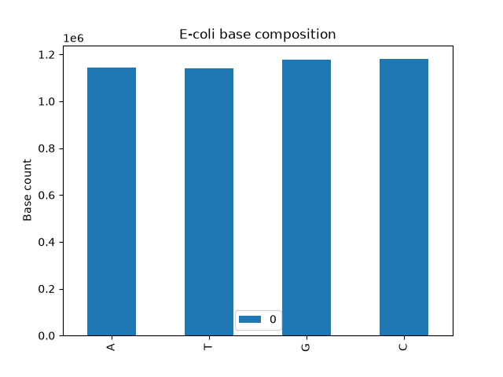

# E. coli BLAST Analysis

Ran a local blastn search of a query sequence against the E. coli K-12 genome (NCBI U00096.3), filtered the tabular results with awk, and plotted the genome's base composition.

## Files

- `ecoli_analysis.py`: basic analysis of the genome sequence (BioPython)
- `base_composition.py`: counts A, T, G, C and saves `base_composition.png`
- `results.txt`: local blastn output in tabular format (`-outfmt 6`)
- `ncbi_results.txt`: BLAST results from NCBI
- `awk_notes.md`: how I filtered the BLAST hits with awk

## How to run

Input files are in `../../data/`. Run from inside this folder, with the conda environment active:

    conda activate pyanalysis
    python base_composition.py

To rebuild the BLAST database and rerun the search:

    makeblastdb -in ../../data/ecoli.fasta -dbtype nucl -out ecoli_db
    blastn -query ../../data/query.fasta -db ecoli_db -outfmt 6 -out results.txt

Filter hits by e-value and show query id, % identity, e-value:

    awk '$11 < 1e-10 {print $1, $3, $11}' results.txt

## Output

## Tools

BLAST+, awk, Python (BioPython, pandas, matplotlib).
