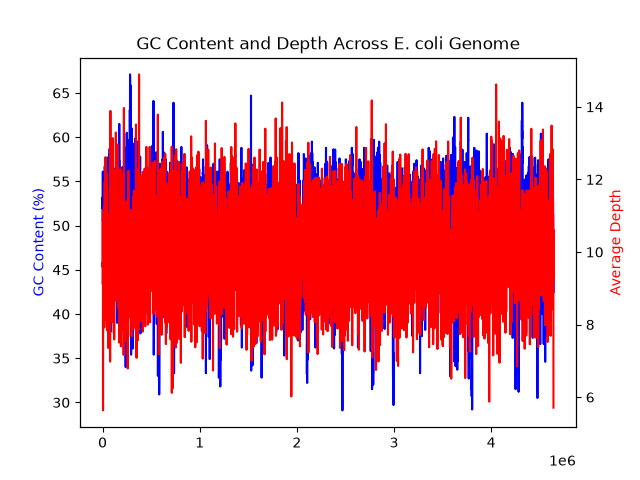

# Genome GC Content and Read Depth Pipeline

Measures two things along the E. coli K-12 genome (NCBI U00096.3) and plots them together: GC content (the share of G and C bases in each 1000 bp window) and read depth (how many sequencing reads cover each position).

## Files

- `sliding_window_gc.py`: computes GC% per 1000 bp window, writes `gc_content.csv` and `gc_content_plot.png`
- `depth_pipeline.sh`: simulates reads, aligns them with minimap2, builds a sorted BAM with samtools, writes `depth.txt`
- `capstone_gc_depth.py`: combines both results into `capstone_gc_depth.png`

## How to run

Run from inside this folder, with the conda environment active:

    conda activate pyanalysis
    python sliding_window_gc.py
    bash depth_pipeline.sh
    python capstone_gc_depth.py

Input genome: `../../data/ecoli.fasta`. Large generated files (reads, BAM, depth.txt) are not tracked in git; the script recreates them.

## Output

## Tools

Python (BioPython, pandas, numpy, matplotlib), minimap2, samtools, bash.
